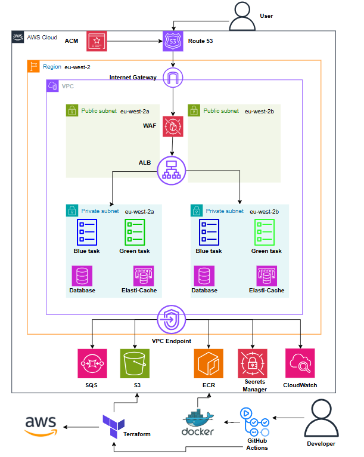
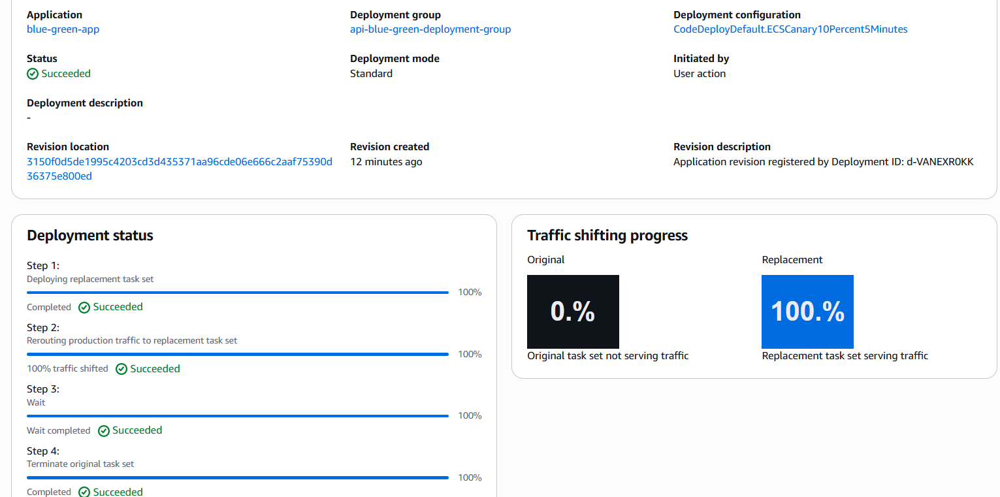
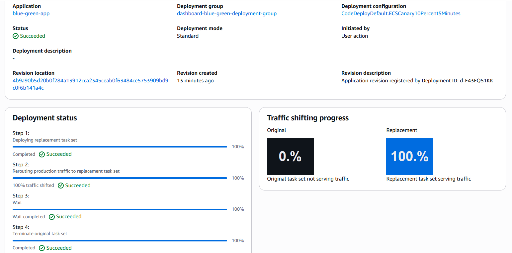
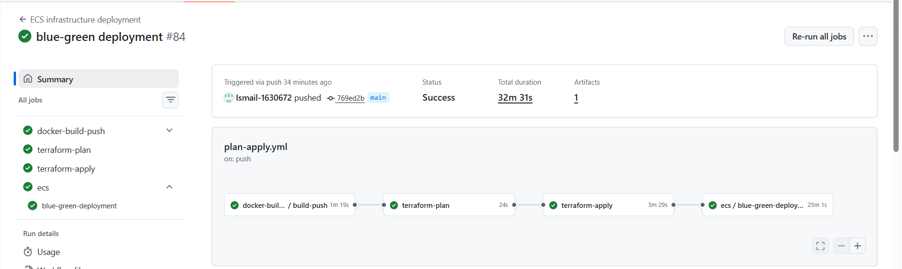
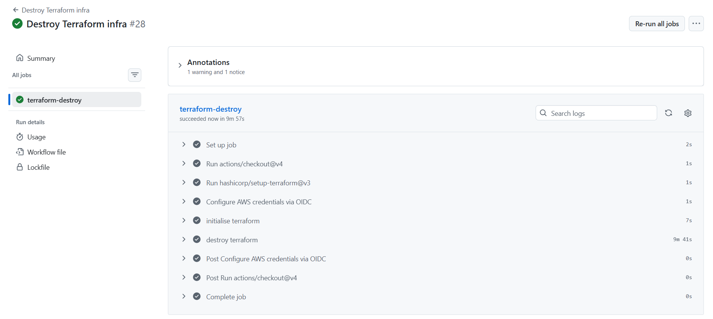
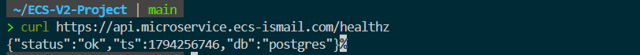
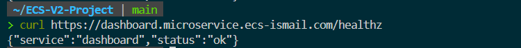

# URL-Shortener - Blue-Green ECS Deployment

## Overview

A containerised URL-shortener deployed on Amazon ECS Fargate using Docker for image builds, Terraform for infrastructure provisioning and GitHub Actions for CI/CD automation.

Rather than a monolithic setup the application consists of 3 microservices:

- **API:** - Handles URL shortening and acts as a producer by sending messages to simple queue service (SQS).
- **Worker:** - Acts as a consumer and polls SQS for messages which it then processes. Writes analytics to PostgreSQL.
- **Dashboard:** - Displays URL analytics and click statistics.

## Architecture

## Key Features

- **Bootstrapping:** - Provisions foundational AWS resources including the OIDC IAM role for GitHub Actions, the ECR repositories for the 3 microservices and the S3 bucket for Terraform state.
- **Web application firewall (WAF):** Protects the application load balancer against common web threats.
- **VPC endpoints:** Provide private connectivity to supported AWS services without relying on a NAT gateway, benefits include cost optimisation and improved security.
- **Amazon SQS:** Decouples the API and worker microservices for asynchronous message processing.
- **CloudWatch Logs:** Centralises ECS application logs for monitoring and troubleshooting.
- **Redis:** Caches frequently accessed URLs to reduce database queries.
- **Application Load Balancer:** Provides HTTPS termination, health checks and host-based routing.
- **AWS CodeDeploy:** Automates blue-green deployments for ECS gradually shifting traffic between existing (blue) and new (green) task sets using a canary deployment strategy. This helps minimise downtime and support rollbacks.
- **Least-Privilege IAM:** Implements fine-grained IAM policies to grant AWS services only the permissions they require to perform their operations, reducing unnecessary access to other AWS resources.

## Database

A database was required for this project to store the application data of the URL-shortener persistently as the ECS tasks themselves are ephemeral and can be stopped, restarted, terminated etc. Over time the analytics dashboard will need to query for top URLs and clickstats. To meet this requirement I decided to use PostgreSQL over Dynamodb as my choice of database as it provides flexible SQL querying including grouping, joining and aggregating data.

## Blue-Green Deployment

AWS CodeDeploy was used to manage blue-green deployments to ECS reducing disruption during application updates, this was done for both api and dashboard microservices. The deployment workflow is as follows:

1. A new docker image is pushed to Amazon ECR.
2. CodeDeploy creates a new ECS green task set.
3. The ALB shifts an initial 10% of production traffic to the green task set while Blue task set receives 90%.
4. After the canary interval 100% of the production traffic shifts to the green task set.
5. The old blue task set is terminated after the configured wait period.

## Docker

Docker was used to containerise the api, worker and dashboard microservices. Images were built using GitHub Actions, tagged with the Git commit SHA and pushed to Amazon ECR before deployment to ECS Fargate.

### Docker best practices I implemented:

- **Multi-stage builds:** Separated build and runtime stages to produce smaller, more efficient images by excluding unnecessary build dependencies.
- **Non-root user:** Ran containers as a non-root user to improve security and reduce the impact of potential container compromises.
- **Docker layer caching:** Optimise Dockerfile instruction ordering to reuse unchanged layers, reducing build times and avoiding unnecessary dependency installations.

## Terraform

Terraform provisions and manages AWS infrastructure, including:

- VPC, subnets, security groups, and VPC endpoints.
- ECS Fargate, ALB, ECR, and CodeDeploy.
- RDS PostgreSQL, ElastiCache Redis, and SQS.
- Route 53, IAM, ACM, WAF, and CloudWatch.

Terraform state is stored remotely in Amazon S3 with state locking enabled.

## CI/CD – GitHub Actions

GitHub Actions automates infrastructure provisioning, Docker builds, and blue-green deployments.

**Pipeline flow:**

1. **Docker:** Build images, tag them with the Git SHA, and push to ECR.
2. **Terraform:** Initialise, plan, and apply infrastructure changes.
3. **Reusable workflows:** Use workflow_call outputs to pass image information from the image build workflow into the blue-green deployment workflow inputs.
4. **Blue-Green Deployment:** Register new ECS task definition revisions and initiate CodeDeploy blue-green deployments.
5. **Destroy:** Use a separate workflow_dispatch workflow to manually trigger Terraform destruction.

AWS authentication is handled securely using GitHub Actions OIDC, avoiding long-lived AWS access keys.

## Application Health Checks

Verified that both the API and Dashboard microservices are accessible over HTTPS through the application load balancer and return successful HTTP responses from their /healthz endpoints.

## API Health check

## Dashboard Health Check

